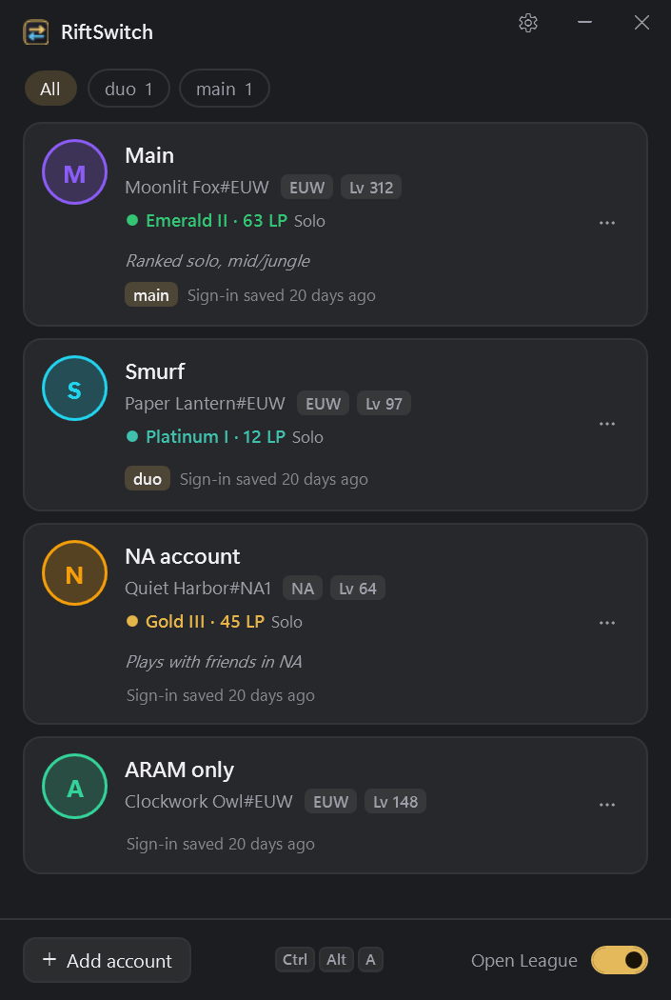
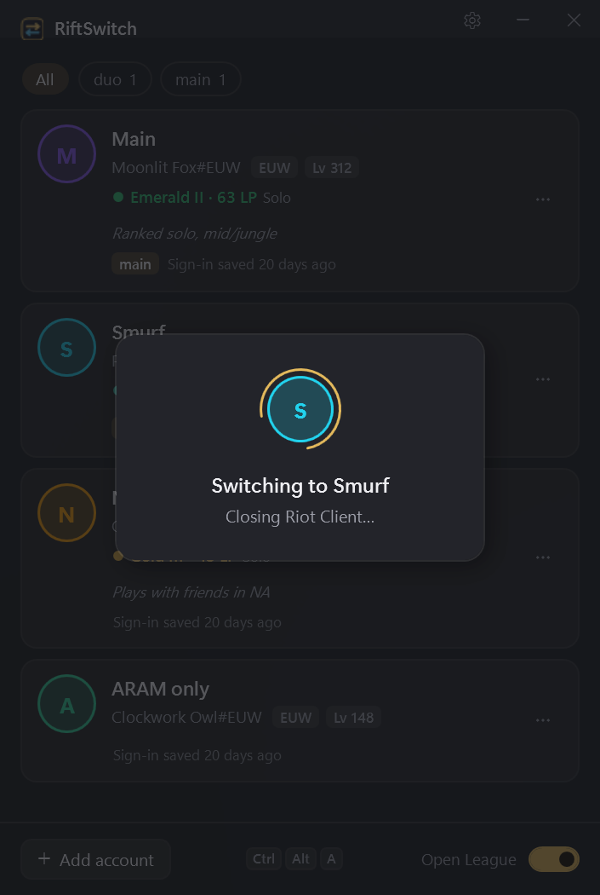
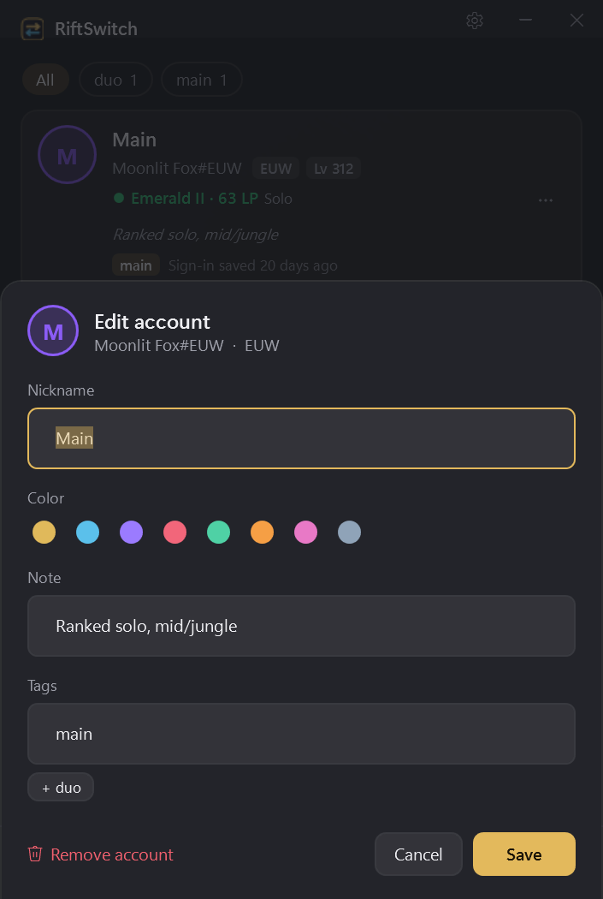
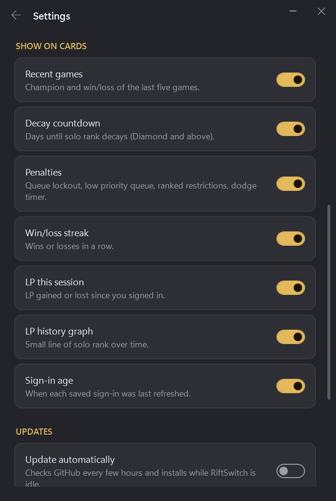

# RiftSwitch

Switch between your Riot accounts in one click. Windows only.

<p align="center"></p>

- **One click or one shortcut.** Press **Ctrl + Alt + A** anywhere, then **1-9** or **Enter**. You can also click an account in the window or the tray menu.
- **No passwords stored.** RiftSwitch keeps a copy of each account's "Stay signed in" session, encrypted with Windows DPAPI so only your Windows user can read it.
- **Sessions stay fresh.** While the Riot Client runs, the session it writes is copied back into the account automatically. Any new account you sign in to with "Stay signed in" is saved too.
- **Ranks at a glance.** Riot ID, region, level, and Solo/Flex rank, read from the League client while it's open on that account.
- **Nicknames, colors and notes** for each account.
- **Won't dodge for you.** Switching is blocked during ready check, champ select or a game.
- **Opens League** after switching (or just the Riot Client, if you turn that off).
- **Updates itself** from GitHub releases. Each download is checked against its SHA-256 hash.

## Use

1. Run `RiftSwitch.exe` (needs the [.NET 10 Desktop Runtime](https://dotnet.microsoft.com/download/dotnet/10.0)).
2. If you're already signed in with "Stay signed in", that account is saved straight away.
3. **Add account** signs the Riot Client out. Sign in to your next account with **Stay signed in** ticked, and it's saved.
4. Switch with a click, or with **Ctrl + Alt + A**.

Don't use **Sign out** in the Riot Client: it ends that session on Riot's side, and you'd need to sign in to it again. If a session does expire, RiftSwitch tells you, and signing in once saves it again.

| | | |
|---|---|---|
|  |  |  |
| Click an account: RiftSwitch closes the Riot Client, swaps the session and opens League. | Give each account a nickname, color, note and tags. | Choose what the cards show: recent games, decay, penalties, streaks, LP. |

The accounts in these screenshots are made up.

## How it works

The Riot Client keeps a "Stay signed in" session in `%LOCALAPPDATA%\Riot Games\Riot Client\Data`. To switch, RiftSwitch:

1. asks the Riot Client to quit (closing League too)
2. saves the current account's latest session
3. puts the target account's saved session in place
4. starts the Riot Client with League

Saved data lives in `%APPDATA%\RiftSwitch`.

RiftSwitch only uses the Riot Client's and League client's own local APIs on `127.0.0.1` to read sign-in state, game phase and ranks. It doesn't touch the game, and it isn't affiliated with Riot Games.

## Release

```powershell
.\release.ps1 1.1.0 "What changed"
```

This sets the version, commits, tags and pushes. GitHub Actions then builds `RiftSwitch.exe` and its `.sha256` and publishes the release.

## Development

`dotnet build`, then run the Debug build with `--selftest` and these test folders set: `RIFTSWITCH_RIOT_DIR` (a fake Riot Client folder), `RIFTSWITCH_RIOT_EXE` (a stand-in exe) and `RIFTSWITCH_DATA`. It runs the full capture, add and switch flow against those folders and writes `selftest.txt`. It refuses to run without them, so it never touches a real Riot Client.
